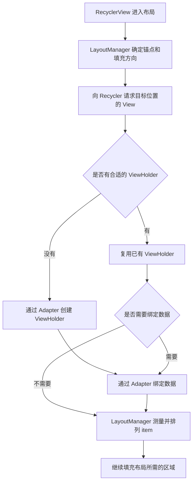

# 🌟整体总结

**基础用法**

RecyclerView 就是用有限的 View 展示大量数据。使用时，Adapter 负责创建 ViewHolder 和绑定数据，LayoutManager 负责排列。

**缓存**

RecyclerView有四种缓存，这四种缓存不是按固定流水线依次存取：

1. Scrap：布局期间暂存已有 Holder，变化项还可能涉及动画处理。
   - Scrap 没有固定的容量上限，按需存放。
2. 本地 Cache（`final ArrayList<ViewHolder> mCachedViews`）：保留离屏但仍有效的 Holder，方便短距离往返。
   - 默认2个，可以通过`recyclerView.setItemViewCacheSize(4)`设置。实际容量上限为设置值 + 预取额外容量，因此大于或等于设置值。
   - 预取数量由 `LayoutManager` 决定：它根据滚动方向和布局情况，告诉 RecyclerView“接下来可能需要哪些 item”。
   - 对于符合缓存条件的新 ViewHolder，`mCachedViews` 满了会先淘汰一个旧的，再放入新的。
   - 被淘汰的 Holder 通常进入 `RecycledViewPool`
3. `ViewCacheExtension`：开发者提供的额外缓存查找入口，默认未设置。
   - 只有一个`getViewForPositionAndType`方法，返回View对象。
4. `RecycledViewPool`：按 viewType 存放可供重新使用的 Holder，可由多个列表共享。
   - 默认每种类型最多保留 5 个，用 `pool.setMaxRecycledViews(viewType, count)` 修改容量。
   - 如果某类型已满，新送来的 Holder 不再入池，不会为它挤掉已有 Holder。

**获取 ViewHolder 的查找顺序**

```text
布局时从 Scrap 里找（具体是要区分 mAttachedScrap 和 mChangedScrap）
    ↓ 未找到
mCachedViews
    ↓ 未找到
询问 ViewCacheExtension（如果设置了）
    ↓ 未找到
从 RecycledViewPool 按 viewType 获取
    ↓ 未找到
调用 onCreateViewHolder() 创建
    ↓
根据有效性和绑定状态，决定是否调用 onBindViewHolder()
```

**bind和unbind**

bind 是把目标数据设置到 Holder 的 View 上，对应 `onBindViewHolder()`。

| 场景                                                    | 是否需要 bind                                   |
| ------------------------------------------------------- | ----------------------------------------------- |
| 新创建的 Holder                                         | 需要，在用于展示目标数据前完成绑定              |
| 从 RecycledViewPool 取出的 Holder                       | 需要，原位置和绑定标记已被重置                  |
| 找回同一数据对应、已绑定且仍有效的 Scrap / Cache        | 通常可以跳过                                    |
| 已有 Holder 的内容被通知更新，且可以继续使用这个 Holder | 需要，可以全量绑定，也可以通过 payload 局部绑定 |

RecyclerView.Adapter没有与bind对应的unbind方法。如果要设计unbind方法，那么合理的时机就是onViewRecycled（RecyclerView.Adapter的方法）或者在两次bind之间调用unbind（因为直接换绑可能不会回调onViewRecycled）。

**数据操作后的bind**

> `onBindViewHolder()` 用来设置 item 的展示内容。仅仅位置变化，通常不需要重新 bind。

假设原列表是 `[A, B, C]`，已有 Holder 可以复用，viewType 不变：

| 数据操作            | 更新后的列表   | 通知方式                        | 通常的 bind 情况                            |
| ------------------- | -------------- | ------------------------------- | ------------------------------------------- |
| 修改 B 的内容       | `[A, B′, C]`   | `notifyItemChanged(1)`          | B 可见时重新完整绑定；A、C 不受影响         |
| 只修改 B 的收藏状态 | `[A, B′, C]`   | `notifyItemChanged(1, payload)` | B 可见时，可通过 payload 只更新收藏图标     |
| 在 B 前插入 X       | `[A, X, B, C]` | `notifyItemInserted(1)`         | X 需要显示时绑定；B、C 单纯因位置后移不重绑 |
| 删除 B              | `[A, C]`       | `notifyItemRemoved(1)`          | 删除本身不要求绑定；C 单纯因位置前移不重绑  |
| 把 A 移到末尾       | `[B, C, A]`    | `notifyItemMoved(0, 2)`         | 只是位置变化，通常不重绑                    |
| 全量刷新            | 任意新列表     | `notifyDataSetChanged()`        | 可见项整体重新绑定、布局                    |

增删操作还可能让其他 item 进入屏幕，进而触发绑定。 例如屏幕只能显示三项：

```
全部数据：[A, B, C, D]
当前显示：[A, B, C]

删除 B 后：
全部数据：[A, C, D]
当前显示：[A, C, D]
```

此时：

- A、C 内容没变，通常无需重绑。
- D 新进入屏幕，需要准备 Holder；如果没有可直接使用的已绑定缓存，就会 bind D。

因此不能固定认为“删除一项就调用几次 bind”。还要看可见范围、缓存状态和内容是否变化。 使用 `ListAdapter + DiffUtil` 时，最终也是通过这些更新通知触发上述行为。

**预取**

RecyclerView 的预取，就是提前准备即将进入屏幕的 item，减少滑动时临时创建和绑定造成的卡顿。例如屏幕显示 A～F，正在向下浏览，RecyclerView 可以提前为 G 准备 Holder。等 G 真正出现时，就有机会直接从缓存取用。

大致流程是：

1. 预测位置：LayoutManager 根据滑动方向等信息，报告可能马上需要的 item。
2. 提前准备：GapWorker 在 UI 线程的可用时间内，尝试获取或创建 Holder，必要时绑定数据。
   - GapWorker 是 RecyclerView 内部负责“预取 ViewHolder”的调度器，目的是提前准备即将显示的 item，减少滑动卡顿。
3. 放入缓存：成功绑定且有效的 Holder 可以进入 `mCachedViews`，等待后续布局使用。

需要记住：

- 默认开启，支持 Android 5.0 及以上；它不是后台线程创建 View，所以 bind 仍然要轻量。
- 预取会增加本地缓存的实际容量，这就是缓存上限可能超过设置值的原因。
- 它准备的是 ViewHolder，不负责网络分页；提前执行 bind 也不代表 item 已经曝光。
- 嵌套列表还有“初始预取”：例如一排横向卡片即将出现时，提前准备其中几个 item，可通过内层 LinearLayoutManager 的 `setInitialPrefetchItemCount()` 调整。

**ListAdapter**

```
ListAdapter.submitList(newList)
AsyncListDiffer 接收新列表，安排后台任务
DiffUtil 比较新旧列表，计算差异，返回DiffUtil.DiffResult
AsyncListDiffer 回到主线程，应用结果（DiffUtil.DiffResult#dispatchUpdatesTo(callback)）
通知 RecyclerView 更新界面
```

- DiffUtil：比较旧列表和新列表，计算增、删、移动、内容变化等更新操作。
  - `DiffUtil.DiffResult#dispatchUpdatesTo(callback)`会分发差异。
  - 而ListAdapter实现了callback接口，在对应的差异回调中调用notifyXXX方法。
- AsyncListDiffer：管理列表快照，把需要的 diff 计算调度到后台，再分发更新。
- ListAdapter：在 Adapter 基类上封装 AsyncListDiffer，提供 `getItem()`、`submitList()` 等接口。

> 普通列表可直接用 ListAdapter；已有其他 Adapter 基类、需要自己控制位置映射时，可以组合 AsyncListDiffer。DiffUtil 本身不会自动切线程，直接调用 `calculateDiff()` 时要自己安排计算与结果应用。
>

身份相同与内容相同

| 回调                   | 判断的问题                             | 示例                   |
| ---------------------- | -------------------------------------- | ---------------------- |
| `areItemsTheSame()`    | 是否是同一个业务实体                   | 文章 ID 是否相同       |
| `areContentsTheSame()` | 同一实体的展示内容是否相同             | 标题、收藏状态是否相同 |
| `getChangePayload()`   | 同一实体的内容改变时，能否描述局部差异 | 只改变了收藏状态       |

例如旧数据为 `ArticleUi(7, "原理", false)`，新数据为 `ArticleUi(7, "原理", true)`：身份相同，内容不同，可以只更新收藏状态。若新 ID 是 8，即使标题相同，也不是同一篇文章。

**payload**

payload 是“哪些内容变了”的说明，Adapter 根据它，只更新受影响的子 View。

```kotlin
override fun onBindViewHolder(
    holder: ArticleHolder,
    position: Int,
    payloads: MutableList<Any>
) {
    if (payloads.isNotEmpty() && payloads.all { it == BOOKMARK_CHANGED }) {
        // 从当前数据读取最终状态，而不是盲目执行“翻转一次”。
        holder.bindBookmark(getItem(position).bookmarked)
    } else {
        // 空 payload 或无法识别的 payload：完整绑定兜底。
        holder.bind(getItem(position))
    }
}
```

再将前文的 companion object 替换为：

```kotlin
companion object {
    private const val BOOKMARK_CHANGED = "bookmark_changed"

    private val DIFF = object : DiffUtil.ItemCallback<ArticleUi>() {
        override fun areItemsTheSame(oldItem: ArticleUi, newItem: ArticleUi) =
            oldItem.id == newItem.id

        override fun areContentsTheSame(oldItem: ArticleUi, newItem: ArticleUi) =
            oldItem == newItem

        override fun getChangePayload(oldItem: ArticleUi, newItem: ArticleUi): Any? {
            return if (oldItem.title == newItem.title &&
                oldItem.bookmarked != newItem.bookmarked
            ) {
                BOOKMARK_CHANGED
            } else {
                null // 标题等其他内容变化时使用完整绑定。
            }
        }
    }
}
```

# 基础使用与组件分工

## 核心组件

- `RecyclerView`：列表容器，协调布局、滚动、更新、动画与复用
- `ViewHolder`：列表Item的view实现
  - 多种 item：重写 `getItemViewType(position)`，按类型创建兼容的 ViewHolder，并在绑定时处理对应数据。
- `Adapter`：提供数量、类型，创建 ViewHolder，并把数据绑定到 View。

## 基本使用

略，只介绍一些不常见但感觉重要的。

### Adapter

adapter的几个重要方法：

```java
//创建ViewHolder实例的，viewType由getItemViewType提供
public RecyclerView.ViewHolder onCreateViewHolder(ViewGroup parent， int viewType) {}

public int getItemViewType(int position) {}

//对RecyclerView子项的数据进行赋值，每个子项在滚动到屏幕的时候会执行。
@Override
public void onBindViewHolder(RecyclerView.ViewHolder holder， int position) {}

//一共有多少子项
@Override
public int getItemCount() {}
```

#### Adapter 组合使用

头部、内容、尾部由独立 Adapter 管理时，可以组合：

```kotlin
// headerAdapter、contentAdapter、footerAdapter 均为已实现的 Adapter。
recyclerView.adapter = ConcatAdapter(
    headerAdapter, contentAdapter, footerAdapter
)
```

ConcatAdapter 默认隔离子 Adapter 的 viewType，以避免类型冲突；只有确认布局、Holder 和绑定约定兼容时，才考虑关闭隔离。

# RecyclerView 和 ListView 区别

两者都支持 View 复用，RecyclerView 的主要优势是扩展能力更强：

- 布局：ListView 主要是纵向列表；RecyclerView 通过 LayoutManager 支持横向、网格、瀑布流等布局。
- ViewHolder：ListView 通常需要开发者自行采用；RecyclerView 将其直接纳入 Adapter API。
- 刷新：RecyclerView 支持增删、移动和局部刷新，配合 DiffUtil、payload 可以减少无效绑定。
- 扩展：RecyclerView 将布局、动画、分割线分别交给独立组件，复杂列表更容易实现和维护。

现在主流使用 RecyclerView，是因为它更适合复杂、多样、频繁更新的列表需求，相关工具也更完善；并不是简单换上它就一定比 ListView 快。


# 布局、滚动与缓存复用原理

## 一个 item 是怎样出现在屏幕上的？

以 LinearLayoutManager 的普通列表为例，可以把主干流程理解为：



## 🌟🌟🌟 RecyclerView 的 四级缓存

### 四级缓存

> 源码并不是四个同性质的缓存按固定流水线依次存取
>

| 机制                                     | 主要用途                                                | 如何理解复用                                      |
| ---------------------------------------- | ------------------------------------------------------- | ------------------------------------------------- |
| Scrap：`mAttachedScrap`、`mChangedScrap` | 布局期间暂存已有 Holder，变化项还可能涉及动画处理       | 尽量找回当前布局需要的 Holder，是否重绑取决于状态 |
| 本地 Cache：`mCachedViews`               | 保留离屏但仍有效的 Holder，方便短距离往返               | 保留绑定关系，合适且未变脏时可直接使用            |
| `ViewCacheExtension`                     | 开发者提供的额外缓存查找入口，默认未设置                | 由开发者管理，不是框架自动维护的一层通用缓存      |
| `RecycledViewPool`                       | 按 viewType 存放可供重新使用的 Holder，可由多个列表共享 | 主要复用视图结构，取出后需要绑定目标数据          |

Scrap 更像**一次布局中的临时工作区**；Cache 更像**最近离屏、还保留原数据关系的 View**；Pool 更像**按结构分类、等着装入新内容的 View**。

#### Scrap

**Scrap 是 RecyclerView 在重新布局时，临时存放已有 ViewHolder 的地方**，方便稍后直接取回来使用，避免重新创建。

- **`mAttachedScrap`**：存放本轮布局可以重新使用的 Holder。数据有效且没变化时，可以直接使用；需要更新时也可能重新绑定。**它不等于“屏幕上所有可见的 View”。**
- **`mChangedScrap`**：主要存放内容已变化、动画机制又不能直接复用来展示新内容的旧 Holder，用于保留旧状态、配合变化动画。**不是所有更新项都会进入这里。**

比如重新布局时，可以先把已有 View 临时放进 Scrap，再按新位置取出并排列。它主要服务于**布局过程中的临时复用**；


**容量**

Scrap 没有固定的容量上限，也没有公开的容量设置接口。
`mAttachedScrap` 和 `mChangedScrap` 都按需要动态增长，数量取决于当前布局和动画需要临时保留多少个 ViewHolder。
布局处理完成后，这些 Holder 会被重新使用或按需回收，Scrap 中的临时记录也会被清理。

> 重新布局常见有这几种情况：
>
> - **首次显示列表**：确定 item 的大小和位置。
> - **数据结构变化**：插入、删除、移动 item，需要调整排列。
> - **尺寸变化**：屏幕旋转、父容器大小变化，或者 item 的文字、图片使高度发生变化。
> - **触发 `requestLayout()`**：例如修改布局参数，需要重新测量和布局。
>
> 但**刷新内容不一定需要重新布局**。例如只修改文字颜色，通常重绘即可；如果文字改变导致高度变化，就需要重新布局。
>
> 另外，**普通滑动主要是移动已有 View、填充新区域、回收离屏 View**，不代表每滑动一帧都会把整个列表重新布局、全部放进 Scrap。

#### 本地 Cache（mCachedViews）

**`mCachedViews` 是 RecyclerView 保存离屏且仍有效的 ViewHolder 的本地缓存。** 滚动回来时，如果数据没变，可以直接复用，通常不需要重新创建和绑定。

- 所有`viewType`共用
- **基础默认容量**：2 个。
- **修改方式**：`recyclerView.setItemViewCacheSize(4)`。
- **实际容量上限**：设置值 + 预取额外容量，因此大于或等于设置值。
- **当前缓存数量**：不一定达到上限，也可能为 0。
- **缓存淘汰**：被淘汰的 Holder 通常进入 `RecycledViewPool`。

#### ViewCacheExtension

使用分三步：

1. 继承 `RecyclerView.ViewCacheExtension`。
2. 重写 `getViewForPositionAndType()`：命中返回关联了 ViewHolder 的 `itemView`，未命中返回 `null`。
3. 调用 `recyclerView.setViewCacheExtension(extension)` 注册。

**缓存的存入、失效和清理由自己管理，RecyclerView 只负责向它查询。** 默认不启用，一般业务很少需要。

#### RecycledViewPool

**`RecycledViewPool` 是按 `viewType` 分组的 ViewHolder 回收池。**

- 复用视图结构，取出后需要重新绑定数据。
- 默认每种类型最多保留 **5 个**。
- 用 `pool.setMaxRecycledViews(viewType, count)` 修改容量。
- 多个 RecyclerView 可通过 `setRecycledViewPool(pool)` 共享，但同类型的 Holder 必须兼容。

#### ViewCacheExtension和RecycledViewPool

- **RecycledViewPool**：通用复用，按 `viewType` 拿一个兼容的 Holder，再绑定目标数据。
- **ViewCacheExtension**：自定义复用入口，让业务按 `position`、`viewType` 和自己的规则，返回特定的缓存 View；查询时机在 Pool 之前。

比如想单独保留少量创建成本很高的特殊 item，就可以通过 Extension 管理。缓存仍然有效时，还可能省去重新绑定。

**大多数业务用默认缓存和 Pool 就够了，Extension 是为特殊需求预留的扩展点。** 使用它需要自行处理缓存失效和清理。


### 🌟获取 ViewHolder 的查找顺序

**stable IDs 默认关闭，ListAdapter 也不会自动开启。** 因此，默认情况下没有“按 itemId 查找”的兜底步骤。

`tryGetViewHolderForPositionByDeadline()` 的默认查找顺序如下，省略状态校验失败、位置映射和预取超时等分支：

```text
布局时从 Scrap 里找（具体是要区分 mAttachedScrap 和 mChangedScrap）
    ↓ 未找到
mCachedViews
    ↓ 未找到
询问 ViewCacheExtension（如果设置了）
    ↓ 未找到
从 RecycledViewPool 按 viewType 获取
    ↓ 未找到
调用 onCreateViewHolder() 创建
    ↓
根据有效性和绑定状态，决定是否调用 onBindViewHolder()
```

- **原数据对应、已绑定且仍有效的 Scrap / Cache**：通常可以跳过绑定。
- **从 Pool 获取或新创建的 Holder**：需要绑定目标数据。
- **找到 Holder 不等于一定能直接使用**：常规复用仍需通过相应的状态、位置和 viewType 校验。

如果主动开启 stable IDs，按位置未找到后，还可以按 `itemId` 与 `viewType` 回查 Scrap / Cache；预布局中的 ChangedScrap 也有按 `itemId` 查找的兜底路径。

隐藏的子 View 常与动画等内部管理有关，不应再机械地算成一个“第几级缓存”。默认情况可以记成：**先按位置找原来的 Holder，找不到再按类型找可用结构。** [RecyclerView 源码](https://raw.githubusercontent.com/androidx/androidx/androidx-main/recyclerview/recyclerview/src/main/java/androidx/recyclerview/widget/RecyclerView.java)


### 缓存放置时机

**查找顺序是获取 Holder 的顺序，放入哪个缓存则取决于 Holder 当前的用途和状态。** 并不是每个 Holder 都依次经过四级缓存。

| 缓存 | 放入时机 |
| --- | --- |
| Scrap | 布局过程中，需要临时拆下已有 View、稍后重新排列或处理变化动画时，将对应 Holder 暂存起来 |
| `mCachedViews` | item 因滚动离屏等原因被回收时，Holder 可回收、未被标记为更新／无效／删除／位置未知，且允许本地缓存时，可以放入 |
| `ViewCacheExtension` | 由开发者自行决定何时存入；**RecyclerView 不会自动向它放入 Holder** |
| `RecycledViewPool` | Holder 从本地 Cache 被淘汰，或可回收但不满足本地缓存条件时，尝试按 viewType 放入 Pool |

`mCachedViews` 还有一种来源：**预取时提前创建并绑定好的有效 Holder，也可能进入本地缓存**，等待后续布局取用。

例如 A 滚动离屏后，若仍然有效且满足缓存条件，就可以保留在 `mCachedViews`；正在参与动画、暂时不可回收的 Holder，则不一定立即入缓存。

### 缓存淘汰时机

| 缓存 | 淘汰或清理时机 |
| --- | --- |
| Scrap | 本轮布局中被重新取用，或布局收尾时按状态回收、清理剩余暂存记录；没有按固定容量淘汰的机制 |
| `mCachedViews` | 容量已满且有新的可缓存 Holder 加入；缓存上限调小；对应 item 被更新、删除而失效，或更换 Adapter 等操作触发清理。被淘汰的 Holder 通常移交 Pool |
| `ViewCacheExtension` | 由开发者自行处理容量限制、数据失效和生命周期清理 |
| `RecycledViewPool` | 调小某种 viewType 的容量时移除超出部分；调用 `clear()` 时清空。如果某类型已满，新送来的 Holder 不再入池，不会为它挤掉已有 Holder |

**从缓存移除，不一定是淘汰，也可能是命中后被取用。** 例如 A 再次需要显示，Recycler 从 `mCachedViews` 取出 A 的 Holder，缓存列表便不再持有它，由布局继续使用。

# 数据更新与局部刷新

## notifyDataSetChanged() 和精确通知有什么区别？

**通知描述的是数据已经发生了什么变化，它本身不会帮你修改数据源。**

| 通知方式                               | 表达的信息                                 | 适用场景                 |
| -------------------------------------- | ------------------------------------------ | ------------------------ |
| `notifyDataSetChanged()`               | 整体数据可能变化，没有明确的变化位置和种类 | 无法给出精确变更时的兜底 |
| `notifyItemInserted(position)`         | 某位置新增一条                             | 已明确完成一次插入       |
| `notifyItemRemoved(position)`          | 某位置删除一条                             | 已明确完成一次删除       |
| `notifyItemMoved(from, to)`            | 同一条数据改变位置                         | 已明确完成一次移动       |
| `notifyItemChanged(position)`          | 同一条数据的展示内容变化                   | 某 item 需要重新绑定     |
| `notifyItemChanged(position, payload)` | 内容变化，并附带局部更新信息               | 收藏、点赞数等局部变化   |

使用 `ListAdapter` 时，则更新业务状态并 `submitList(newList)`，由差异计算生成通知。不要同时手工发送一套插入删除通知，否则容易把同一次变化报告两遍。

# 状态错乱与常见异常

## 为什么会出现图片、选中状态或文字错乱？

同一个 ViewHolder 会绑定不同的数据；任何没被新绑定覆盖的可变状态，都可能把上一条数据的表现带过来。 可以按同步状态残留和异步结果竞态两类排查。

## 点击事件为什么不应该保存 onBindViewHolder() 的 position？

`onBindViewHolder()` 收到的位置只代表绑定时的位置。插入、删除或移动可能改变位置，却不必重新绑定其他内容没有变化的 item，因此监听器闭包里的旧 position 可能失效。

前文示例在点击发生时查询 `holder.bindingAdapterPosition`，并检查 `RecyclerView.NO_POSITION`，之后再读取当前数据。

| 位置 API                  | 适合的用途                                                   |
| ------------------------- | ------------------------------------------------------------ |
| `bindingAdapterPosition`  | 相对实际绑定该 Holder 的 Adapter；子 Adapter 读取自己的数据常用它 |
| `absoluteAdapterPosition` | 相对 RecyclerView 顶层 Adapter；ConcatAdapter 中包含前面子 Adapter 的偏移 |
| `layoutPosition`          | 最近一次布局计算中的位置；主要用于布局相关逻辑               |

item 已删除、Holder 已回收，或全量通知后新布局尚未完成等情况下，可能拿到 `NO_POSITION`，不能直接作为数组下标。

还有一个容易漏掉的问题：若 item 展示“第几名”，绑定内容依赖 position，单纯插入或移动后，受影响项未必重绑。应把名次作为 UI 数据参与比较，或明确更新受影响内容，不要假设位置改变必然触发绑定。

## onViewRecycled() 和 onViewDetachedFromWindow() 有什么区别？

`onViewDetachedFromWindow()` 表示 View 离开窗口；`onViewRecycled()` 表示 Holder 准备被回收复用。 两者都是 `RecyclerView.Adapter` 的回调。

| 对比       | `onViewDetachedFromWindow()`   | `onViewRecycled()`                  |
| ---------- | ------------------------------ | ----------------------------------- |
| 触发含义   | itemView 从窗口脱离            | Holder 准备清理内部状态、移交回收池 |
| 原数据绑定 | 可能继续保留，稍后直接显示     | 可以清理旧数据相关资源              |
| 常见处理   | 暂停视频、动画等展示行为       | 取消旧请求、释放图片等资源          |
| 后续使用   | 可能重新 attach，无需重新 bind | 从池中取出后，需要绑定目标数据      |

一个典型过程：

```
A 正在显示
    ↓ 滑出屏幕并脱离窗口
onViewDetachedFromWindow(A)
    ↓
A 进入 mCachedViews，保留原绑定
    ├─ 很快滑回来 → onViewAttachedToWindow(A)，可能无需 bind
    └─ 被缓存淘汰 → onViewRecycled(A)，尝试进入 RecycledViewPool
```

所以，如果在 `onViewDetachedFromWindow()` 中暂停了播放或动画，应考虑在 `onViewAttachedToWindow()` 中恢复，不能只等下一次 bind。 而 `onViewRecycled()` 适合清理旧绑定资源，回调后 Holder 仍可能被复用。

# 性能优化与复杂场景

## RecyclerView 滑动卡顿排查和优化

略。

## 嵌套 RecyclerView 如何优化？共享 Pool 有什么前提？

常见场景是纵向频道列表中，每个频道有一个横向卡片列表。可以考虑：

- 创建外层 Holder 时初始化内层 RecyclerView、LayoutManager、Adapter，绑定频道时更新其数据，减少重复初始化。
- 兼容的内层列表共享 `RecycledViewPool`，减少同类卡片重复创建。
- 结合横向首屏实际需要的 item 数量，评估 `initialPrefetchItemCount`，再测量收益。
- 用频道 ID 保存内层滚动位置；外层 Holder 换绑频道时恢复对应状态，避免沿用上一个频道的滚动位置。

共享 Pool 按 **viewType** 查找，并不会自动理解“这个 Holder 原来属于哪个 Adapter”。必须保证同一个类型值对应兼容的布局、Holder、主题以及绑定和事件处理约定。

尤其要检查监听器：前面的单列表示例在创建 Holder 时捕获了 Adapter，若改造成跨 Adapter 共享 Pool，需要重新设计回调，例如在绑定时更新当前数据和操作入口，避免复用后仍然访问旧 Adapter。Pool 生命周期也应与页面及其 View 使用环境匹配。

对于同方向嵌套，要先看测量约束。把一个很长的 RecyclerView 放进滚动容器并让它随全部内容展开，可能导致一次布局大量 item，丧失只布局窗口附近内容的优势。可以优先考虑单个 RecyclerView 配合多类型或 ConcatAdapter。单纯禁用 nested scrolling 只改变滚动协作，不会自动修复测量问题。
