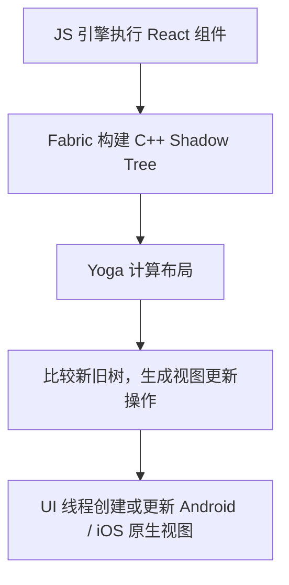

# 常见用法

RN是声明式 UI，用组件描述界面，用状态驱动界面更新，通过事件和 API 完成交互。

## 使用组件和 JSX 构建界面

JSX 是写在 JavaScript 中的界面描述语法：

```
function Welcome({name}) {
  return (
    <View>
      <Text>你好，{name}</Text>
    </View>
  );
}

// 使用自定义组件
<Welcome name="Android 开发者" />
```


## 使用 state 管理变化

`state` 是组件自己维护的状态。

```
import React, {useState} from 'react';
import {View, Text, TextInput, Pressable} from 'react-native';

function Greeting({title}) {
  const [name, setName] = useState('');

  return (
    <View>
      <Text>{title}</Text>

      <TextInput
        value={name}
        onChangeText={setName}
        placeholder="请输入名字"
      />

      <Text>你好，{name}</Text>

      <Pressable onPress={() => setName('Android 开发者')}>
        <Text>填入默认名字</Text>
      </Pressable>
    </View>
  );
}
```

这里的过程是：

```
用户输入 → onChangeText → setName → 重新计算界面 → 更新显示
```

这种 `value` 由 state 决定、输入事件再更新 state 的写法，叫受控输入。

使用 state 时，记住三点：

- 更新依赖旧值时，用 `setCount(count => count + 1)`。
- 更新对象或数组时创建新值，例如 `setUser(old => ({...old, name: '小明'}))`。
- `setName()` 影响下一次渲染；同一个事件函数中立即读取 `name`，仍然是当前这次渲染的值。


## 使用 Hooks 处理状态、副作用和引用

这三个 Hook 最先需要掌握：

| Hook        | 用途                                 | 修改后是否触发界面更新     |
| ----------- | ------------------------------------ | -------------------------- |
| `useState`  | 保存输入内容、加载状态等界面数据     | 通过 setter 请求更新       |
| `useEffect` | 注册监听、管理定时器、同步外部系统   | 本身不会，内部可更新 state |
| `useRef`    | 保存组件引用、定时器编号、请求代次等 | 不会                       |

例如，定时器需要在组件卸载时清理：

```
useEffect(() => {
  const timer = setInterval(() => {
    setCount(count => count + 1);
  }, 1000);

  return () => clearInterval(timer);
}, []);
```

### useEffect

`useEffect` 的依赖数组决定什么时候重新执行：

- `[]`：挂载时建立副作用，卸载时清理。
- `[userId]`：首次执行，以及 `userId` 变化后执行。
- 不传依赖数组：每次提交渲染后执行。

重新执行前也会清理上一次副作用。开启开发模式的 StrictMode 时，还可能额外执行一次建立和清理。

### useRef

`useRef` 常用于操作输入框：

```
const inputRef = useRef(null);

<TextInput ref={inputRef} />

<Pressable onPress={() => inputRef.current?.focus()}>
  <Text>开始输入</Text>
</Pressable>
```

这里需要保存输入框引用，但引用变化无需刷新界面，因此适合使用 ref。


## 与 Android 原生通信

这部分是当前 Hybrid Demo 的重点。工程使用 RN 0.72.17 的传统桥接，主要有三条链路：

| 方向      | 方式               | 当前 Demo 的例子                       |
| --------- | ------------------ | -------------------------------------- |
| 原生 → RN | 初始 props         | `initialMessage`、`source`、`loadMode` |
| RN → 原生 | 调用 Native Module | 查询设备信息、显示 Toast               |
| 原生 → RN | 事件订阅           | `HybridDemoMessage`                    |

# React Native 跨端原理

React Native（RN）的核心思路是：**用 JavaScript / TypeScript 和 React 描述界面与业务逻辑，由框架在 Android、iOS 上创建和更新原生 UI。** 各端复用业务代码和组件描述，平台差异由底层适配层处理。

## 页面如何显示出来

以 RN 新架构为例，一次渲染可以简化为：



- **JS 引擎**：例如 Hermes，负责执行 JS 业务代码。
- **Shadow Tree（影子树）**：记录组件属性、层级和布局信息，供渲染器计算使用。
- **Yoga**：根据样式和布局约束计算尺寸、位置。
- **原生视图**：例如 Android 上的 `ViewGroup`、`TextView`。框架也会合并可省略的视图层级，减少原生节点。

当状态变化时，React 重新计算相关组件，渲染器将差异应用到原生视图。例如计数从 `1` 变为 `2`，最终只需要更新对应文本等发生变化的部分。

## JS 如何与原生通信

**旧架构使用 Bridge**：JS 与原生之间主要通过异步、批量、序列化消息通信。高频调用或大量数据传输时，会增加序列化、排队和跨线程调度开销。

**新架构主要包含以下机制**：

| 机制         | 作用                                                         |
| ------------ | ------------------------------------------------------------ |
| JSI          | 提供 JS 与 C++ 交互的接口，可持有对象引用并直接调用，减少旧 Bridge 的序列化开销 |
| Fabric       | 新渲染器，负责影子树、布局与原生视图更新流程                 |
| TurboModules | 新原生模块系统，支持按需加载，用于暴露存储、设备能力等原生 API |
| Codegen      | 根据类型声明生成 JS 与原生之间的接口代码，减少类型不一致问题 |

JSI 支持同步交互，但具体调用仍取决于 API 和线程安排；耗时工作仍需合理调度。
